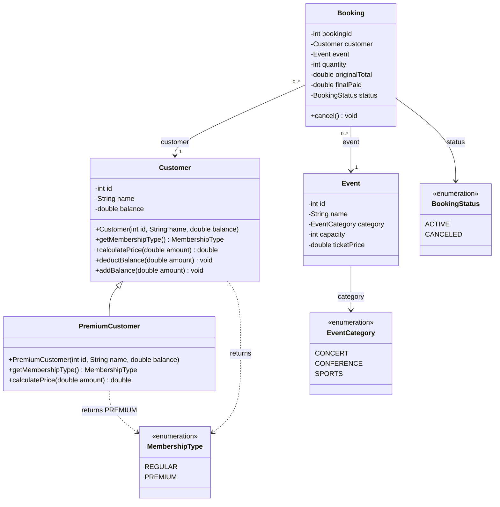
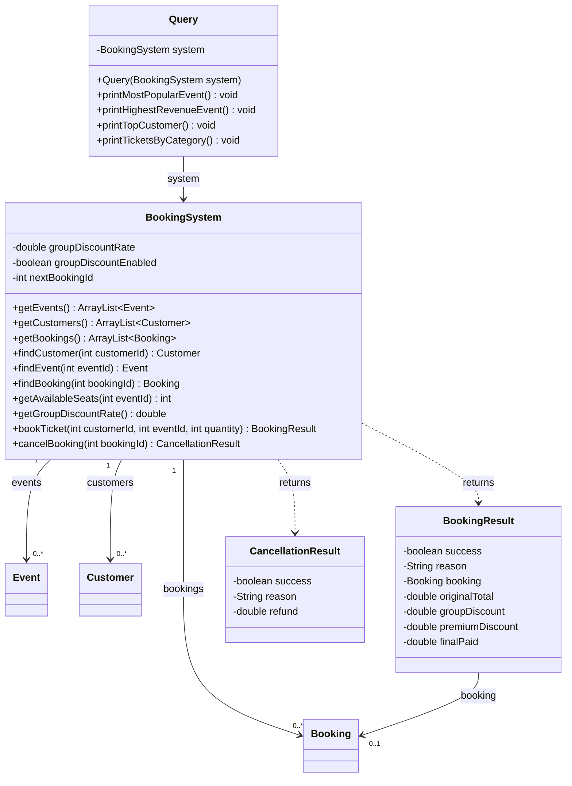
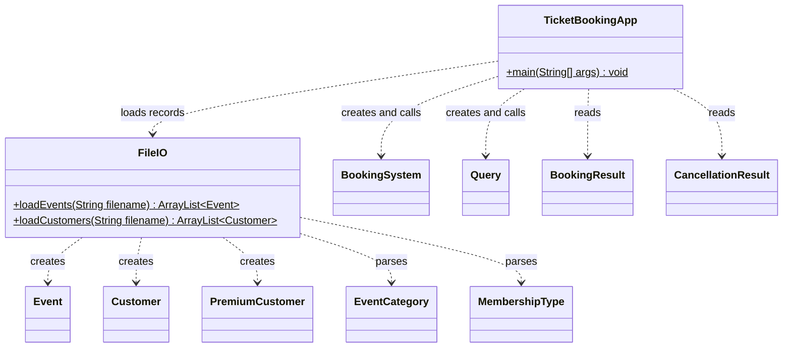

# Class diagram

The diagrams describe the source in `src/ticketbooking`. Solid arrows show stored references or inheritance. Dashed arrows show method-level dependencies. Collection multiplicities indicate the number of objects a field can reference.

## Domain model

Customer, Event, Booking, and the result classes provide getters for their stored data. PremiumCustomer inherits customer identification and balance operations and overrides membership and price calculation. Event capacity always represents total capacity. Remaining seats are calculated by BookingSystem.

## Booking operations and reporting

A failed purchase returns a BookingResult with a null booking and zero monetary fields. A successful purchase stores a Booking and returns its reference. CancellationResult reports success or failure and the refunded amount.

## Loading and application entry points

TicketBookingApp runs the public demonstration. FileIO reads UTF-8 CSV rows and creates the corresponding model objects.

## Purchase and cancellation flow

1. BookingSystem finds the customer and event and validates quantity and available seats.
2. It calculates the original total and any enabled group discount.
3. It calls `customer.calculatePrice(...)`. The actual customer type selects the regular or premium implementation.
4. It checks the final payment against the balance. On success it deducts payment, stores the booking, and advances the ID.
5. For cancellation it finds an active booking, changes its status, and credits its final paid amount back to the customer.
6. Query reads only ACTIVE bookings when calculating reports.
